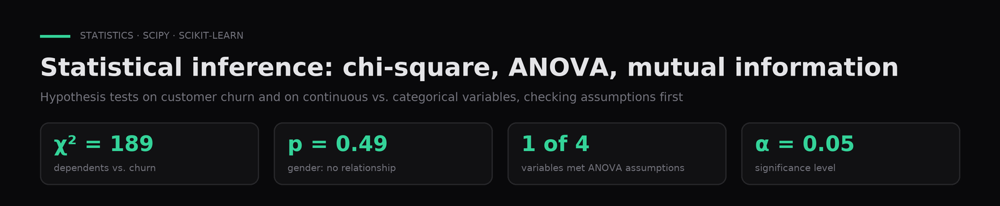

# Statistical inference with chi-square, ANOVA and mutual information

**Hypothesis tests applied to telecom customer churn and to the relationship between continuous and categorical variables, checking assumptions before each test.**

`Python` · `SciPy` · `pandas` · `scikit-learn` · `Seaborn` · [Leer en español ↓](#español)

---

## Problem

Determine which variables are truly related to an outcome instead of assuming it.

## Data

Telco Customer Churn (7,043 customers, categorical features and `churn`), a color-preference survey with three alternative outcomes, and a course-provided `anova_05.csv` (5,000 rows, 4 continuous variables and an A/B/C category). The files are not included.

## Approach

Chi-square tests of independence at α = 0.05; mutual information; ANOVA only where normality (Shapiro-Wilk) and equal variances (Levene) hold.

## Results

Having dependents (χ² = 189.1) and a partner (χ² = 158.7) are associated with churn, while gender is not (p = 0.49). ANOVA was applied only to the one variable that met its assumptions.

| Test | Question | Finding |
|---|---|---|
| Chi-square of independence | Which customer traits are related to churn? | Dependents (χ² = 189.1) and Partner (χ² = 158.7) are; gender (p = 0.49) and phone service (p = 0.34) are not |
| Sanity check | Is `customerID` related to churn? | χ² = 7,043 but p = 0.49: an identifier with one level per row tells you nothing, a good reminder to drop IDs |
| Shapiro-Wilk + Levene | Can ANOVA be used at all? | Only `x2` met normality and equal variances |
| ANOVA on `x2` | Do group means differ? | F = 1.46, p = 0.23: no evidence of a difference |
| Mutual information | Which variable separates A/B/C best? | `x1`, with group means of 2.5, 9.2 and 16.1 |

## How to run

1. `pip install -r requirements.txt`, or open the notebooks in Google Colab.
2. Upload the CSV/TAB files each notebook reads from `/content` (the Telco churn data is public on [Kaggle](https://www.kaggle.com/datasets/blastchar/telco-customer-churn)).
3. `notebooks/01_chi_square_survey.ipynb`, `notebooks/02_chi_square_churn.ipynb`, `notebooks/03_anova_mutual_information.ipynb`.

## Context

Coursework for **Data Mining** in the AI & Data Science program (Colegio Universitario IES · Universidad Siglo 21, 2026). Author: **Gaspar Quintana**.

---

## Español

**Pruebas de hipótesis aplicadas a la fuga de clientes de una telco y a la relación entre variables continuas y categóricas, verificando los supuestos antes de cada test.**

**Problema.** Saber qué variables se relacionan de verdad con un resultado, en lugar de suponerlo.

**Datos.** Telco Customer Churn (7.043 clientes, variables categóricas y `churn`), una encuesta de colores con tres escenarios alternativos, y `anova_05.csv` de la cátedra (5.000 filas, 4 variables continuas y una categoría A/B/C). Los archivos no se incluyen.

**Método.** Chi cuadrado de independencia con α = 0,05; información mutua; ANOVA solo donde se cumplen normalidad (Shapiro-Wilk) y homogeneidad de varianzas (Levene).

**Resultados.** Tener dependientes (χ² = 189,1) y pareja (χ² = 158,7) se asocian con la fuga de clientes, y el género no (p = 0,49). ANOVA se aplicó solo a la única variable que cumplía los supuestos.

**Contexto.** Trabajo de **Minería de Datos**, Tecnicatura en IA y Ciencia de Datos (Colegio Universitario IES · Universidad Siglo 21, 2026). Autor: **Gaspar Quintana**.
